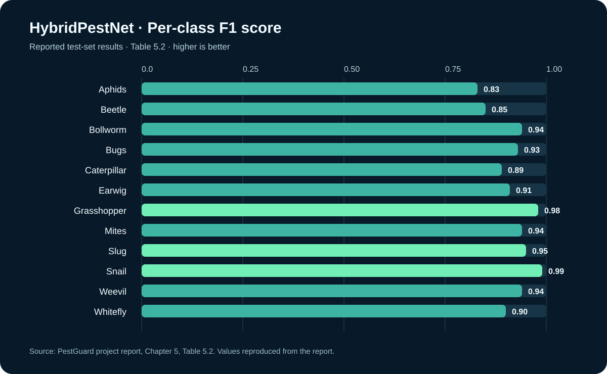
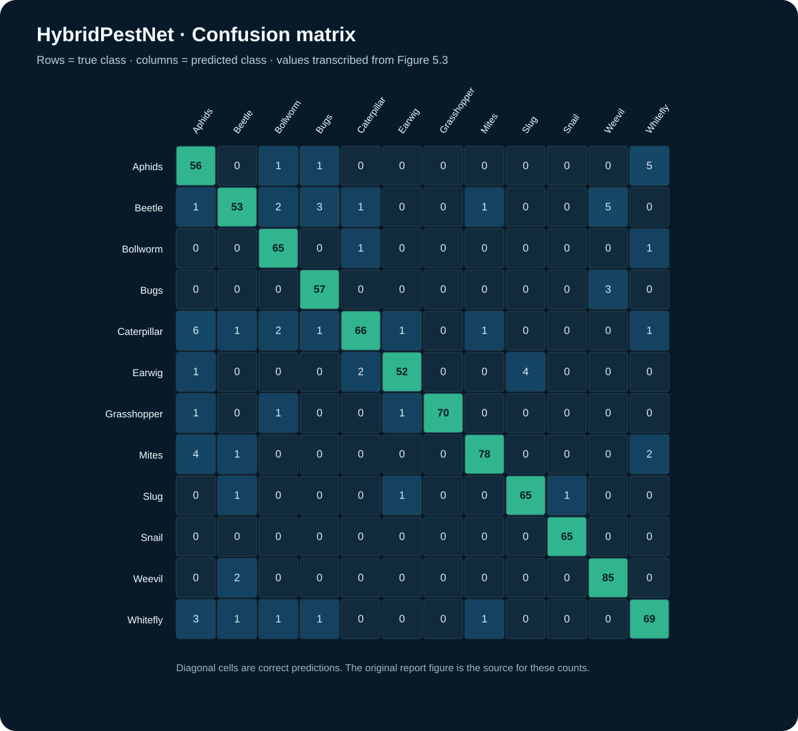
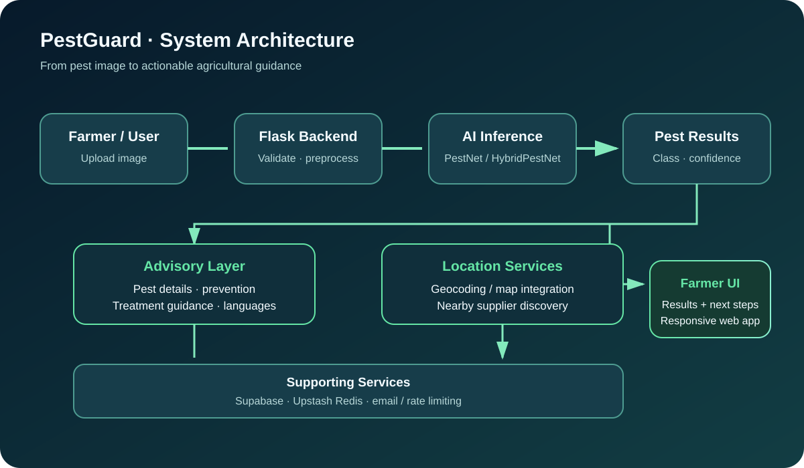

<div align="center">

# PestGuard

### AI-powered pest detection and agricultural advisory

**Identify crop pests. Understand the result. Explore practical next steps.**

[](https://www.python.org/)
[](https://flask.palletsprojects.com/)
[](https://www.tensorflow.org/)
[](https://docs.ultralytics.com/)
[](https://supabase.com/)

</div>

---

## At a glance

PestGuard is a computer-vision web application built to help users identify crop pests from images and access pest information, treatment and prevention guidance, and location-based supplier discovery. It combines deep-learning experiments with a Flask application and supporting cloud services.

| Reported result | Value |
|---|---:|
| HybridPestNet test accuracy | **92.10%** |
| Standalone PestNet CNN test accuracy | **76.42%** |
| YOLO-assisted pipeline accuracy | **88.17%** |
| YOLO detector mAP@0.5 | **0.943** |
| Classification dataset | **8,400 images · 12 classes** |

<sub>Metrics are reproduced from the project report, Chapter 5. Classification accuracy and YOLO localization metrics describe different evaluation tasks and are not directly interchangeable.</sub>

## Why PestGuard?

- **Image-based pest identification** using a trained classification model.
- **Multiple model approaches:** HybridPestNet, a standalone CNN (PestNet), and a YOLOv8-assisted detection pipeline.
- **Pest guidance** covering pest details, treatment suggestions, and prevention information.
- **Multilingual advisory experience** intended to make information more accessible.
- **Location-aware discovery** for nearby pesticide suppliers.
- **Web application** built with Flask, with supporting database, caching, email, and request-control services.

## Results and model evaluation

| Model / pipeline | Reported metric | Reported result |
|---|---|---:|
| HybridPestNet (EfficientNet + custom CNN head) | Test accuracy | **92.10%** |
| Standalone PestNet CNN | Test accuracy | **76.42%** |
| YOLO-assisted pipeline | Pipeline accuracy | **88.17%** |
| YOLOv8 detector | mAP@0.5 | **0.943** |

### HybridPestNet per-class F1 score



### HybridPestNet confusion matrix



The confusion matrix is transcribed from Figure 5.3 in the project report. It is included to make the reported evaluation easier to inspect; it is not a newly generated evaluation from model predictions.

## System architecture



**High-level flow:** image upload → preprocessing → model inference → pest result → advisory and location-aware services → results presented to the user.

The application code also integrates Supabase and Upstash Redis. Advisory and geolocation features depend on the configuration and external services enabled for a deployment.

## Technology stack

| Layer | Technologies |
|---|---|
| Application | Python, Flask, HTML, CSS, JavaScript |
| Classification | TensorFlow / Keras, EfficientNet-based hybrid model, custom CNN |
| Object detection | YOLOv8 / Ultralytics |
| Image processing | Pillow, NumPy and preprocessing utilities |
| Data and caching | Supabase, Upstash Redis |
| Supporting services | Email, geocoding / location lookup, rate limiting and compression |

## Pest classes

The report evaluates these 12 classification labels:

**Aphids · Beetle · Bollworm · Bugs · Caterpillar · Earwig · Grasshopper · Mites · Slug · Snail · Weevil · Whitefly**

## Repository layout

```text
PestGuard/
├── app.py
├── config.py                 # local configuration; do not commit secrets
├── best_pestnet.keras        # trained model expected by the app
├── class_names.json
├── requirements.txt
├── templates/
├── static/
├── hybrid-approach.ipynb
├── custom-cnn-from-scratch.ipynb
├── YOLOv8_HybridPest_Pipeline_Kaggle.ipynb
└── docs/
    └── assets/
        ├── architecture.svg
        ├── hybridpestnet-f1.svg
        └── hybridpestnet-confusion-matrix.svg
```

## Run locally

### 1. Clone the repository

```bash
git clone https://github.com/parampreetchahal/PestGuard.git
cd PestGuard
```

### 2. Create and activate a virtual environment

**Windows (PowerShell)**

```powershell
py -m venv .venv
.venv\Scripts\Activate.ps1
```

**macOS / Linux**

```bash
python3 -m venv .venv
source .venv/bin/activate
```

### 3. Install dependencies

```bash
python -m pip install --upgrade pip
pip install -r requirements.txt
```

> **Dependency note:** the current `requirements.txt` appears to include machine-specific package entries. If installation fails on another machine, create a clean, portable requirements file from the working environment rather than assuming the existing export is portable.

### 4. Configure credentials

Set up the configuration expected by `app.py` in a local `config.py` or adapt the application to read environment variables. The application references Supabase credentials, Upstash Redis credentials, a Flask secret key, and mail configuration.

**Never commit API keys, passwords, tokens, or production credentials.** Keep local configuration private and provide a redacted example configuration for collaborators.

### 5. Start Flask

```bash
python app.py
```

The application loads `best_pestnet.keras` and `class_names.json` at startup. Ensure both files are present at the expected paths. Some features may also require correctly configured external services.

## Reproducibility and interpretation

- The classification dataset is reported as 8,400 images across 12 classes, split into training, validation, and test sets in an 80:10:10 ratio.
- HybridPestNet uses 300 × 300 input images in the report; the standalone CNN uses 224 × 224.
- The YOLO detection dataset is reported separately as 4,300 manually annotated images.
- These are project-report results, not a guarantee of performance on new crops, camera conditions, or geographic regions.
- Pest identification and treatment suggestions should be treated as decision support, not a substitute for qualified agricultural advice or pesticide-label instructions.

## Project status

PestGuard is an academic/research prototype. Deployment readiness depends on environment configuration, portable dependency management, model availability, and the external services used by the application.

## Contributors

Developed as a team project at **Graphic Era Hill University, Dehradun**.

- **Parampreet Singh** — [GitHub](https://github.com/parampreetchahal) · [LinkedIn](https://www.linkedin.com/in/parampreet-singh23/)
- Project teammates and mentor are acknowledged in the academic project report.

## License

No explicit license file was verified during this documentation pass. Add a repository license before describing the project as open source or specifying reuse permissions.
